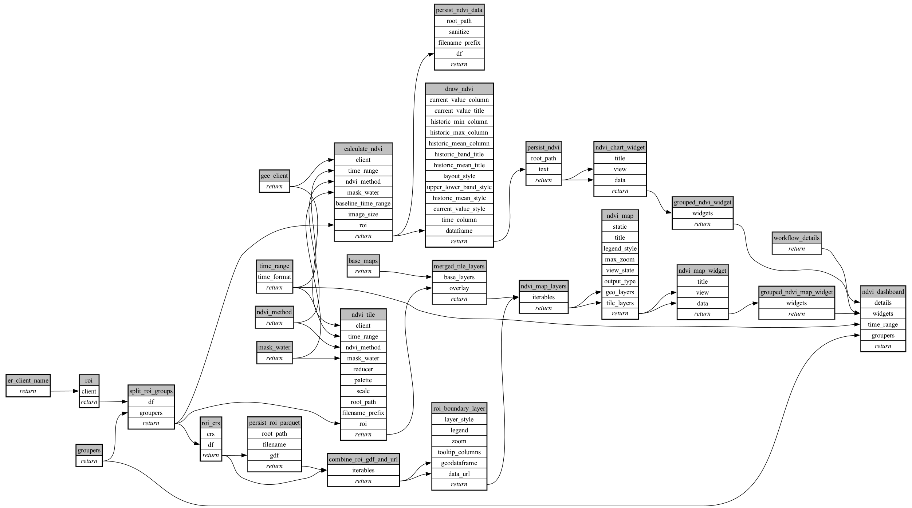

```
# AUTOGENERATED BY ECOSCOPE-WORKFLOWS; see fingerprint in README.md for details

```

```yaml
# fingerprint:
artifacts_sha256_basic: c72622824416ff90d349cfa2df3f367bb4eb54e29ce7d49db7b7a906453ccd5e
artifacts_sha256_strict: 9c45d8135320165085ab9028ae9635a17103994f30ca31a562376fa0e039611a
installed_requirements:
- channel: https://repo.prefix.dev/ecoscope-workflows/
  name: ecoscope-platform
  version: {version: ==2.32.0}
- channel: conda-forge
  name: pydeck
  version: {version: ==0.9.2}
params_sha256: 745aff3f56918a89f9315d217f47d7af9efa61ed7d595a70b495aa44c9632859
spec_sha256: 70e622dca69a23320c33dffd95876ad42711bef17e4a185d3893526b3efc871e

```

# ecoscope-workflows-ndvi-workflow


